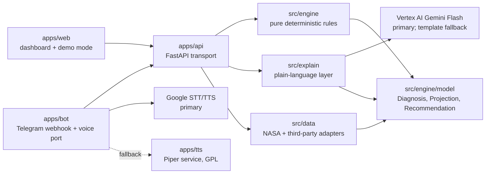
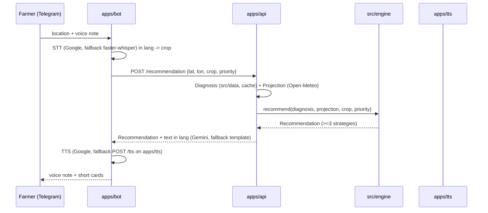

<!-- AI-assisted: drafted with Claude Code (Periélio, BMad architecture, headless fast path) from the PRD and the existing code; pending review by Ravi (Tech Lead). -->

# Architecture Spine — Field Shift farmer product (front B)

> **Change of Nov 15 (Ravi, Tech Lead; `sprint-change-proposal-2026-11-15.md`):** the Telegram bot and voice are **out of v1**. In this document:
> - `apps/bot`, `apps/tts`, **AD-6** and the stack rows python-telegram-bot, google-cloud-speech, google-cloud-texttospeech, faster-whisper and piper-tts no longer apply;
> - the bot and TTS Cloud Run services leave **AD-10**;
> - **AD-1:** the only product client is `apps/web`;
> - **AD-9:** the dashboard defaults to `en`; the bot default is dropped;
> - **AD-3** stays as the rule for any AI use the team defines after discovery.
>
> The diagrams below still show the bot as the Nov 14 record. Nothing else changes.

## Design Paradigm

The architecture is **layered ports-and-adapters**. Dependencies point inward only.



| Layer | Path | Role |
|---|---|---|
| Adapters | `src/data/` (existing) + `src/data/open_meteo.py`, `src/data/srtm.py` | Fetch, clip, cache and normalize data into the shared series shape. |
| Domain | `src/engine/` | **Pure** functions: Diagnosis + Projection + Crop + Priority → Recommendation. |
| Explanation | `src/explain/` | Turns a Recommendation into plain text with Gemini Flash, falling back to a template. It never decides anything. |
| Transport | `apps/api/` | FastAPI. The only entry point for clients. |
| Clients | `apps/bot/`, `apps/web/` | The Telegram bot and the dashboard. |
| Side service | `apps/tts/` | Piper TTS behind HTTP: the voice **fallback**, isolated because Piper is GPL. |

## Invariants & Rules

### AD-1 — Clients talk only to the API
- **Binds:** FR-1 to FR-19, `apps/bot`, `apps/web`.
- **Prevents:** the bot and the dashboard computing different answers for the same Plot.
- **Rule:** `apps/bot` and `apps/web` call `apps/api` over HTTP only. They never import `src/data`, `src/engine` or `src/explain`. The single exception is the internal map (front A), which keeps reading the static snapshots.

### AD-2 — The engine is pure and deterministic
- **Binds:** FR-8, FR-9, FR-10, FR-11, FR-12.
- **Prevents:** recommendations that change between calls, and network or AI calls hidden inside the rules.
- **Rule:** `src/engine` has no I/O, no network, no clock and no randomness.
  - Its inputs are typed Diagnosis, Projection, Crop, Priority and reference data, such as crop profiles and ZARC windows, loaded by the caller.
  - Its outputs are a Recommendation.
  - The same inputs give a byte-identical output, and tests assert this.
  - Crop profiles and rule thresholds live in versioned data files under `src/engine/rules/`, not in code.

### AD-3 — AI explains and never decides
- **Binds:** FR-13.
- **Prevents:** an LLM changing numbers, strategies or rankings.
- **Rule:** `src/explain` takes a finished Recommendation and returns text only. Numbers reach the text only through placeholders filled from the structured Recommendation. A check rejects any number in the output that is not in the input.
  - The provider is **Vertex AI Gemini Flash**.
  - If the call errors, the quota runs out, or the check fails, the response falls back to a fixed template.
  - The template text exists for both languages.
  - The API always returns both the structured Recommendation and the text.

### AD-4 — One owner per shape
- **Binds:** FR-4, FR-5, FR-7, FR-17, FR-19.
- **Prevents:** the API, the snapshots and the dashboard drifting into three time-series formats.
- **Rule:**
  - Diagnosis and Forecast series use the series shape in `docs/data-format/series.schema.json`, owned by #16: `time`, `values{VAR}`, `unit`, `source`, `nasa`.
  - The Recommendation has its own schema, `docs/data-format/recommendation.schema.json`, owned by `src/engine`.
  - Each schema is changed only by its owner, in the same PR as the code that changes it.

### AD-5 — Forecast lives behind the API only [ADOPTED]
- **Binds:** FR-7, NFR-3.
- **Prevents:** Open-Meteo leaking into the snapshots or being mistaken for NASA data.
- **Rule:**
  - Only `apps/api` calls `src/data/open_meteo.py`.
  - Every forecast series carries `nasa: false` and the Open-Meteo attribution.
  - The snapshot generator never imports `open_meteo`.

### AD-6 — Voice port with fallback; GPL boundary for Piper [ADOPTED] — WITHDRAWN Nov 15 (no voice in v1)
- **Binds:** FR-15, FR-20, NFR-4, NFR-6.
- **Prevents:** GPL code entering the Apache-2.0 product, and the voice going silent when the primary engine fails.
- **Rule:**
  - `apps/bot` talks to voice only through one port, `transcribe(audio, lang)` and `synthesize(text, lang)`.
  - The primary adapters are Google Cloud Speech-to-Text and Text-to-Speech.
  - The fallback adapters are faster-whisper (MIT, runs in `apps/bot`) and Piper. Piper runs **only** inside `apps/tts`, behind `POST /tts`. No product package imports `piper`.
  - Each adapter receives `lang`, which is `pt-BR` or `en`.
  - Audio is OGG/Opus at every boundary.

### AD-7 — Stateless requests, cache keyed by place [ADOPTED]
- **Binds:** FR-19, NFR-1, NFR-2.
- **Prevents:** accounts, stored farmer data, and a demo that fails when NASA services are slow.
- **Rule:**
  - There are no user accounts, and no farmer data is persisted.
  - The response cache is keyed by `(source, lat/lon rounded to 0.01°, period)` and lives in `data/cache/api/`.
  - The two Pilot sites are pre-warmed, and the API serves them from cache when the upstream service fails.
  - The judge path is the dashboard demo mode plus the bot `/start`. It needs no login.

### AD-8 — Secrets and config only from env or Secret Manager [ADOPTED]
- **Binds:** NFR-5.
- **Prevents:** tokens in Git, long-lived keys in CI, and per-service config formats.
- **Rule:**
  - Every service reads its config from environment variables, with names listed in `.env.example` and empty values.
  - On Cloud Run, the secrets are Secret Manager references mounted as environment variables: `TELEGRAM_BOT_TOKEN`, `EARTHDATA_USERNAME` and `EARTHDATA_PASSWORD`.
  - Google APIs (Vertex AI, Speech-to-Text, Text-to-Speech) use the service account of the Cloud Run service, with no API key.
  - GitHub Actions authenticates to GCP through **Workload Identity Federation**, with no JSON key.
  - The other variables are `API_BASE_URL`, `TTS_URL`, `EXPLAIN_MODEL`, `GCP_PROJECT` and `GCP_REGION`.

### AD-9 — Language is a request parameter; structure is language-neutral [ADOPTED]
- **Binds:** FR-13, FR-15, FR-20, FR-21.
- **Prevents:** the engine or the cache forking by language, and mixed-language replies.
- **Rule:**
  - Every client sends `lang`, which is `pt-BR` or `en`. The bot defaults to `pt-BR` and the dashboard to `en`.
  - The Recommendation is language-neutral: ids, numbers and codes.
  - Only `src/explain`, the template strings and the UI strings depend on `lang`.
  - The cache stores the structured result once, and texts are keyed by `lang`.
  - The bot keeps the chat's `lang` in memory for the session only. It is not stored on disk, in line with AD-7.

### AD-10 — Google Cloud deployment envelope [ADOPTED]
- **Binds:** NFR-1, NFR-2, NFR-6.
- **Prevents:** a scale-to-zero bot that misses updates, surprise costs, and drift between services.
- **Rule:**
  - Each of `apps/api`, `apps/bot` and `apps/tts` is a separate **Cloud Run** service. They share one region and use no GPU.
  - The bot receives Telegram updates by **webhook**, never by long polling.
  - The API keeps the pre-warmed pilot cache in its image or on a mounted volume. If the cache is lost, the API recomputes it.
  - The project has a **budget alert of US$ 50**.
  - The judge-facing endpoints are public, with no authentication.



## Consistency Conventions

| Concern | Convention |
|---|---|
| Naming | Use the Glossary terms from the PRD as type and field names: `Plot`, `Crop`, `Priority`, `Strategy`, `Diagnosis`, `Projection`, `Recommendation`. Write them in snake_case in JSON and Python. |
| Ids | A Crop id is lowercase English (`beans`, `maize`, `cassava`). A Priority is one of `water`, `soil`, `erosion`, `income`. A Strategy kind is one of `current_practice`, `soil_water_conservation`, `resilient_income_forage`. |
| Dates | Use ISO 8601. Daily values are dates; sub-daily values are UTC datetimes with `Z`. |
| Units | Each variable carries its unit, as in the snapshot format: mm/day, °C, m³/m³, NDVI dimensionless. |
| Errors | Return `{error: {code, message}}` with HTTP 400, 404, 422, 502 or 504, as in the earlier contract draft. Never return a stack trace. |
| Attribution | Every series and every Recommendation lists its sources with `nasa` true or false. |
| Logging | Log JSON lines to stdout. Never log tokens, raw audio or full coordinates; round coordinates to 0.1°. |

## Stack

Versions were checked on PyPI and npm on 2026-11-14. The `src/data` dependencies stay as pinned in `requirements.txt`.

| Name | Version |
|---|---|
| Python | 3.12 |
| FastAPI | 0.162.7 |
| Uvicorn | 0.54.0 |
| Pydantic | 2.14.3 |
| httpx | 0.28.1 |
| python-telegram-bot | 22.8 |
| google-genai (Vertex AI Gemini) | 3.3.0 |
| google-cloud-speech | 2.41.0 |
| google-cloud-texttospeech | 2.38.0 |
| google-cloud-secret-manager | 2.32.0 |
| google-github-actions/auth | v3 |
| google-github-actions/deploy-cloudrun | v3 |
| faster-whisper (fallback) | 1.2.1 |
| piper-tts (fallback, in `apps/tts` only) | 1.8.0 |
| MapLibre GL JS (dashboard) | 6.18.0 |

## Structural Seed

```text
src/engine/            # pure rules (AD-2), model types, rules/*.yaml crop profiles and thresholds
src/explain/           # plain-language layer (AD-3)
apps/api/              # FastAPI: /recommendation, /diagnosis, /forecast, /health, /sources
apps/bot/              # python-telegram-bot + faster-whisper
apps/tts/              # Piper HTTP service (GPL boundary, own container)
apps/web/              # dashboard (front A map components reused) + demo mode
docs/data-format/      # series.schema.json (#16), recommendation.schema.json (engine)
```

```mermaid
graph TB
  subgraph Public, no login
    W[Dashboard static site]
    TG[Telegram]
  end
  subgraph Google Cloud - Cloud Run, one region, budget alert US$ 50
    API[apps/api service]
    BOT[apps/bot service, Telegram webhook]
    TTS[apps/tts service, Piper fallback]
    SM[Secret Manager]
    VX[Vertex AI Gemini Flash]
    GV[Speech-to-Text / Text-to-Speech]
    C[(data/cache/api)]
  end
  W --> API
  TG <--> BOT
  BOT --> API
  BOT --> GV
  BOT -.fallback.-> TTS
  API --> VX
  API --> SM
  BOT --> SM
  API --> C
  API --> NASA[NASA services: POWER, CMR/Earthdata, GIBS]
  API --> OM[Open-Meteo, not NASA]
```

## Deferred

- **Dashboard framework and location.** The dashboard either extends `apps/web` (Gabriel's stack choice, recorded in AGENTS.md section 2) or becomes a separate route of the same app. Decided with #12.
- **Exact Gemini Flash model id** (`EXPLAIN_MODEL`). It is pinned at deploy time to the current GA Flash model on Vertex AI.
- **ZARC access format** (file or API). Research is in progress. It becomes reference data loaded by the API and passed to the engine (AD-2).
- **Rule thresholds for the v1 crops** (maize, beans and cassava). The team decides them, and they live in `src/engine/rules/`.
- **Credit window.** The Global Offers credits last 90 days from activation. Before submission, confirm that they cover Jan 26, 2027, or that the always-free tiers carry the services after the credits end.
